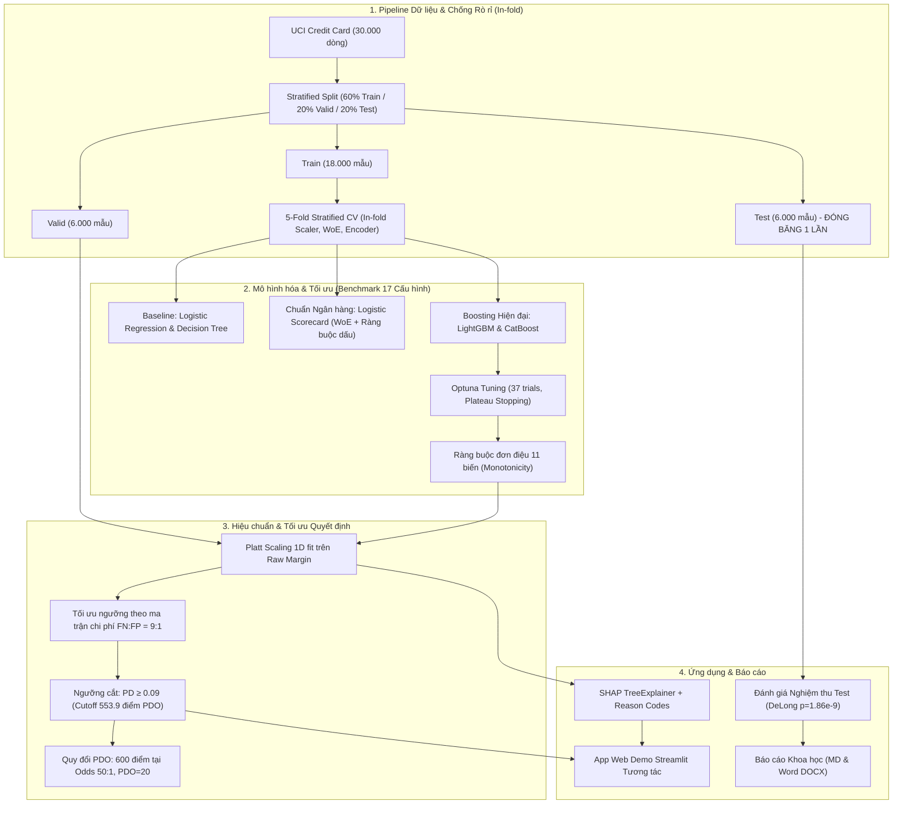

# AI Credit Scoring: Dự Đoán Xác Suất Vỡ Nợ & Cảnh Báo Sớm Rủi Ro Danh Mục Thẻ Tín Dụng

[](.github/workflows/ci.yml)


Pipeline dự đoán xác suất vỡ nợ (Probability of Default, PD) trong tháng kế tiếp cho danh mục thẻ tín dụng hiện hữu, xây dựng trên bộ dữ liệu **Default of Credit Card Clients** (Đài Loan, 30.000 hồ sơ, tỷ lệ nợ xấu 22.12%). 

Dự án so sánh 17 cấu hình thuật toán có kiểm định thống kê, áp đặt **ràng buộc đơn điệu nghiệp vụ** (Monotonic Constraints), **hiệu chuẩn xác suất Platt scaling** bảo toàn tính cộng tính của SHAP, **tối ưu ngưỡng cắt theo ma trận chi phí rủi ro ngân hàng**, giải thích bằng **SHAP theo nhóm đặc trưng**, và cung cấp ứng dụng **Streamlit** tương tác.

> **Định vị nghiệp vụ:** Mô hình được thiết kế làm **Hệ thống Cảnh báo Sớm (Early Warning System)** và hỗ trợ quản trị danh mục (Portfolio Management), không phải hệ thống phê duyệt mở thẻ mới (Underwriting) theo chuẩn Basel 12 tháng, và không dùng thay thế phán quyết con người khi chưa kiểm định Out-of-Time.

---

## 1. Kết Quả Chính

| Hạng mục Nghiệm thu | Kết quả Thực nghiệm | Mốc Sàn Charter | Đánh giá & Kiểm định Thống kê |
|---|:---:|:---:|---|
| **Mô hình Chính thức** | **LightGBM Tuned + Monotonic + Platt Scaling** | – | Ràng buộc đơn điệu trên 11 biến nợ/hạn mức, loại bỏ biến `SEX` |
| **ROC-AUC trên tập Test** | **0.7825** (95% CI: `[0.7681, 0.7973]`) | $\ge 0.7800$ | **Đạt Mốc Sàn Charter** |
| **So với Baseline Logistic** | **$\Delta\text{AUC} = +0.0215$** (Test) | $\Delta > 0$ | **DeLong test: $p = 1.86 \times 10^{-9}$ (KPI Chính Đạt)** |
| **ROC-AUC 5-Fold CV (Train)**| **0.7906 ± 0.0074** | $\ge 0.7900$ | Vượt mốc mục tiêu; Paired t-test 5/5 fold $p = 0.00406$ |
| **PR-AUC trên tập Test** | **0.5600** (95% CI: `[0.5315, 0.5887]`) | $\ge 0.5600$ | **Đạt Mốc Sàn Charter** |
| **Gini / KS trên tập Test** | **Gini: 0.5649** / **KS: 0.4290** | $0.57$ / $0.45$ | Khoảng tin cậy 95% Bootstrap bao phủ mốc sàn |
| **Ngưỡng Vận hành Tối ưu** | **$p^* \ge 0.09$ (Cutoff 553.9 điểm PDO)** | – | Tối ưu theo ma trận chi phí $FN:FP = 9:1$ ($LGD=0.45, EAD=BILL\_AMT1$) |
| **Hiệu quả Giảm Chi phí** | **NT$1,634.49 / khách hàng** | – | **Giảm 42.25% tổn thất kỳ vọng** so với ngưỡng 0.50 (NT$2,830.29) |
| **Phân tầng Rủi ro Demo** | **Bình thường** ($PD < 9\%$) • **Theo dõi** ($9\% \le PD < 27\%$) • **Cảnh báo cao** ($PD \ge 27\%$) |

---

## 2. Kiến Trúc Pipeline



---

## 3. Cấu Trúc Repository

```
2627I-INT3011E_2-AICreditScoring/
├── app/                  # Ứng dụng web Streamlit demo (final model, baseline, mock)
├── configs/              # Cấu hình dự án (config.yaml, feature_freeze_v1.yaml, tuned_params.yaml)
├── data/
│   ├── raw/              # Dữ liệu gốc (không commit; có file băm SHA-256)
│   └── splits/           # Chỉ số dòng chia Train/Valid/Test (commit splits.json)
├── docs/                 # Hướng dẫn chi tiết & tài liệu học phần
│   └── GETTING_STARTED.md               # Hướng dẫn từng bước từ bản clone sạch
├── models/               # final_model.pkl: Mô hình nghiệm thu chính thức cho demo
├── notebooks/            # Notebooks phân tích (01 EDA, 02 Modeling, 03 SHAP, 04 Calibration, 05 Error/Fairness)
├── reports/              # Báo cáo kỹ thuật chuyên sâu & kết quả nghiệm thu Test
│   ├── model_comparison.md              # Báo cáo Phương pháp & So sánh mô hình (Markdown)
│   ├── model_comparison.docx            # Báo cáo Phương pháp & So sánh mô hình (Word DOCX)
│   ├── final_report.md                  # Báo cáo Tổng kết toàn bộ đồ án
│   ├── model_card.md                    # Model Card chuẩn mực công nghiệp
│   └── test_evaluation/                 # Nghiệm thu tập Test (metrics CSV, curves PNG)
├── scripts/              # Mã nguồn CLI thực thi toàn bộ pipeline, calibration, XAI, fairness
├── src/                  # Thư viện lõi (preprocessing, features, train, calibrate, scoring, evaluate, explain, fairness)
├── tests/                # 304 automated unit tests (Pytest, độ bao phủ 87%)
├── pyproject.toml        # Cấu hình build & pytest
├── requirements.txt      # Thư viện ghim phiên bản cụ thể (Python 3.11/3.12)
└── README.md
```

---

## 4. Hướng Dẫn Cài Đặt & Chạy Lại Từ Bản Clone Sạch

### Bước 1: Khởi tạo Môi trường Ảo
Yêu cầu Python 3.11 hoặc 3.12. Không cài thư viện trực tiếp vào Python hệ thống.

```bash
# Tạo môi trường ảo
python -m venv .venv

# Kích hoạt môi trường:
# Windows (PowerShell):
.venv\Scripts\Activate.ps1
# Linux / macOS:
source .venv/bin/activate

# Cài đặt thư viện
pip install -r requirements.txt
```

### Bước 2: Tải Dữ liệu & Chạy Toàn Bộ Pipeline

Chạy tuần tự các lệnh sau từ thư mục gốc của repository:

```bash
# 1. Tải dữ liệu vào data/raw/ và tự động kiểm tra checksum SHA-256
python scripts/download_data.py

# 2. Huấn luyện baseline (Logistic Regression & Decision Tree), log MLflow
python scripts/run_pipeline.py --mode baseline

# 3. Xuất mô hình nghiệm thu cuối cùng tại models/final_model.pkl
python scripts/run_pipeline.py --mode final-model

# 4. Phân tích lỗi định lượng và tính công bằng (Fairness) trên Valid
python scripts/analyze_errors.py
python scripts/analyze_fairness.py

# 5. Đánh giá tính công bằng trên tập Test (đọc file dự đoán đã khóa, không chấm lại Test)
python scripts/analyze_fairness.py --split test

# 6. Khởi chạy Ứng dụng Web Demo Streamlit
streamlit run app/streamlit_app.py

# 7. Chạy kiểm thử toàn bộ dự án
pytest
```

---

## 5. Các Chế Độ Huấn Luyện CLI (`scripts/run_pipeline.py`)

Hệ thống hỗ trợ các chế độ chạy qua cờ `--mode`:

| Chế độ (`--mode`) | Mô tả Chi tiết & Tác vụ Thực hiện | Thời gian Ước tính |
|---|---|:---:|
| `baseline` *(mặc định)* | Huấn luyện Logistic Regression và Decision Tree qua 5-Fold Stratified CV | ~10 giây |
| `advanced`, `boosting` | Huấn luyện Random Forest, XGBoost; LightGBM, CatBoost (tham số mặc định) | ~1 phút |
| `imbalance` | Thử nghiệm `class_weight='balanced'` và `SMOTE` in-fold | ~2 phút |
| `scorecard`, `woe` | Trích xuất IV, phân khoảng WoE, huấn luyện Logistic Scorecard ràng buộc dấu | ~30 giây |
| `tune` | Tối ưu siêu tham số bằng Optuna (LightGBM $\pm$ monotonic, CatBoost) với plateau stop | ~45–60 phút |
| `tuned` | Huấn luyện lại mô hình với siêu tham số đã chốt; thêm `--include-sex` để đối chiếu | ~3–5 phút |
| `summary`, `compare` | Tổng hợp bảng so sánh CV và xuất `reports/model_comparison.csv` | ~5 giây |
| `calibrate` | So sánh Platt/Isotonic, quét ngưỡng chi phí, xuất báo cáo calibration | ~2 phút |
| `final-model` | Xuất `models/final_model.pkl` (LightGBM tuned + Platt + ngưỡng 0.09) cho demo | **< 15 giây** |

*Giao diện theo dõi thí nghiệm MLflow: Chạy `mlflow ui --backend-store-uri ./mlruns` và mở `http://localhost:5000`.*

---

## 6. Ứng Dụng Web Demo Streamlit

Ứng dụng web (`app/streamlit_app.py`) nạp trực tiếp mô hình cuối từ `models/final_model.pkl` và giải thích thời gian thực bằng `shap.TreeExplainer`:
- **Đầu vào:** Nhập thông số hồ sơ linh hoạt hoặc chọn nhanh **3 hồ sơ mẫu chuẩn**:
  * *Hồ sơ Bình thường:* $PD = 4.0\%$, Điểm tín dụng 614 (Mức Bình thường).
  * *Hồ sơ Ca biên (Borderline):* $PD = 26.0\%$, Điểm tín dụng 517 (Mức Theo dõi).
  * *Hồ sơ Cảnh báo cao:* $PD = 73.3\%$, Điểm tín dụng 440 (Mức Cảnh báo cao).
- **Đầu ra:** Xác suất vỡ nợ đã hiệu chuẩn $PD$, Điểm tín dụng theo thang PDO (300–850), Mức cảnh báo rủi ro kèm **Hành động đề xuất** cụ thể cho cán bộ tín dụng (Theo dõi định kỳ / Nhắc nợ SMS / Giảm hạn mức / Chuyển thu hồi sớm).
- **Giải thích:** Biểu đồ **SHAP Waterfall Plot** phân rã chi tiết đóng góp của từng nhóm đặc trưng (Lịch sử trễ hạn, Mức sử dụng hạn mức, Hành vi trả nợ, Biến động dư nợ, Nhân khẩu học) và Top 10 đặc trưng ảnh hưởng mạnh nhất.
- **Dự phòng (Fallback):** Khi chưa có mô hình cuối, ứng dụng tự động chuyển sang mô hình Baseline từ MLflow hoặc Mock model kèm cảnh báo giao diện.

---

## 7. Danh Mục Báo Cáo Kỹ Thuật

Tài liệu kỹ thuật và kết quả nghiên cứu được lưu trữ trong thư mục `reports/`:

| Lĩnh vực | Tài liệu Báo cáo Chi tiết | Nội dung Cốt lõi |
|---|---|---|
| **Phương pháp & So sánh (Word)** | [`reports/model_comparison.docx`](reports/model_comparison.docx) | Bản Word chuẩn in ấn, font Times New Roman, đầy đủ bảng số liệu |
| **Phương pháp & So sánh (Markdown)**| [`reports/model_comparison.md`](reports/model_comparison.md) | Biện luận 4 nhóm mô hình, 4 căn cứ chọn LightGBM Monotonic, kiểm định DeLong |
| **Báo cáo Tổng kết** | [`reports/final_report.md`](reports/final_report.md) | Tổng kết toàn diện đồ án, phân tích lỗi, công bằng, hạn chế và khuyến nghị |
| **Model Card** | [`reports/model_card.md`](reports/model_card.md) | Đặc tả kỹ thuật mô hình, phạm vi sử dụng, dữ liệu và đánh giá rủi ro |
| **Nghiệm thu Test** | [`reports/test_evaluation/test_evaluation.md`](reports/test_evaluation/test_evaluation.md) | Biên bản đánh giá 1 lượt duy nhất trên Test, ROC/PR curves và khoảng tin cậy |
| **Hiệu chuẩn & Ngưỡng** | [`reports/calibration_threshold.md`](reports/calibration_threshold.md) | So sánh Platt vs Isotonic, ma trận chi phí FN:FP = 9:1, quy đổi điểm PDO |
| **Giải thích XAI & Lý do** | [`reports/xai_report.md`](reports/xai_report.md) | Phân tích SHAP Global/Local, bảo toàn tính cộng tính, hệ thống Reason Codes |
| **Phân tích Lỗi & Công bằng** | [`reports/error_analysis_validation.md`](reports/error_analysis_validation.md) | Bản chất 102 ca FN, Disparate Impact Ratio theo giới tính và tuổi tác |

---

## 8. Minh Bạch Sử Dụng AI & Đạo Đức Học Thuật

Tuân thủ **Tiêu chí 6 trong Thang điểm trình bày cuối kỳ**:
- **Công cụ AI hỗ trợ:** Nhóm sử dụng công cụ AI (ChatGPT, Claude, Gemini) cho mục đích tra cứu cú pháp thư viện, gợi ý cấu trúc boilerplate code, hỗ trợ định dạng Markdown và gợi ý các kịch bản kiểm thử biên cho pytest.
- **Làm chủ cốt lõi:** 100% các quyết định quan trọng (lựa chọn bài toán cảnh báo sớm, thiết kế kiến trúc Pipeline in-fold chống rò rỉ dữ liệu, xây dựng ma trận chi phí $FN:FP = 9:1$, chứng minh tính bảo toàn tuyến tính giữa Platt scaling và SHAP, quyết định loại biến nhạy cảm `SEX`, và phân tích bản chất sai số FN/FP) đều do các thành viên nhóm tự nghiên cứu, tính toán và bảo vệ.
- **Cơ chế kiểm chứng:** Toàn bộ mã nguồn và công thức toán học đều được bảo đảm bằng **304 unit tests tự động** và kiểm định độc lập. Các đề xuất sai lệch của AI (như rò rỉ dữ liệu khi fit scaler trước CV hay lỗi không gian logit của hàm calibration mặc định) đều được nhóm phát hiện và sửa đổi hoàn chỉnh.

---

## 9. Phân Công Thành Viên & Đóng Góp

Dự án được thực hiện bởi nhóm 3 thành viên:
- **Thành viên A (Data Engineer / Analyst):** Thu thập, làm sạch dữ liệu, EDA, kỹ thuật đặc trưng (Feature Engineering), xây dựng Logistic Scorecard (WoE), phân tích lỗi và đánh giá tính công bằng (Fairness).
- **Thành viên B (ML Engineer):** Chiến lược phân chia dữ liệu, thiết kế pipeline kiểm thử, huấn luyện baseline, tuning Optuna, áp đặt ràng buộc đơn điệu, hiệu chuẩn xác suất (Platt scaling), lựa chọn ngưỡng tối ưu theo ma trận chi phí, quy đổi điểm PDO, đánh giá nghiệm thu tập Test, refactor mã nguồn và cập nhật README.
- **Thành viên C (Explainability & Product):** Xây dựng Project Charter, phân tích SHAP toàn cục/cục bộ, hệ thống Reason Codes, xây dựng ứng dụng web demo Streamlit, Model Card, và tổng hợp báo cáo.
