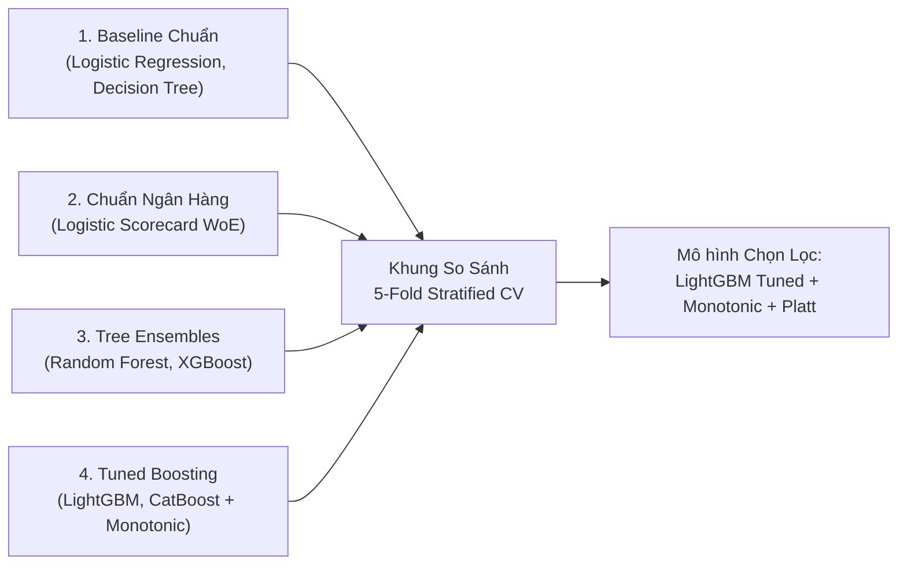

# Báo cáo Phương pháp và Kết quả So sánh Mô hình (Model Comparison & Methodology Report)

_Dự án: AI Credit Scoring — Phân vai: Thành viên B (ML Engineer) — Tuần 3: Nhiệm vụ T4 & T5_

---

## 1. Mục tiêu và Bối cảnh Thực hiện

Theo phân công trách nhiệm tại **Mục 2.1 & 4.3 (Tuần 3 – T4)** trong [`reports/project_plan.md`](project_plan.md):
- **Phân vai Thành viên B (ML Engineer):** Phụ trách chiến lược chia dữ liệu, pipeline đánh giá, baseline, huấn luyện 17 cấu hình mô hình, tuning Optuna, calibration, tối ưu ngưỡng theo ma trận chi phí, quy đổi điểm PDO, và đánh giá tập Test nghiệm thu một lần duy nhất.
- **Nhiệm vụ:** Hoàn thiện báo cáo toàn diện về **Phương pháp luận lựa chọn mô hình** và **Kết quả so sánh thực nghiệm**, đối chiếu với **Thang điểm trình bày cuối kỳ – Fintech (100đ)**:
  * **Tiêu chí 2: Kỹ thuật lựa chọn (20đ):** Biện luận lý do chọn kỹ thuật, tính đúng đắn của quy trình chống rò rỉ dữ liệu, và tính phù hợp với bài toán tín dụng ngân hàng.
  * **Tiêu chí 4: Kết quả thực nghiệm (20đ):** Sử dụng đầy đủ thước đo chuyên ngành (ROC-AUC, PR-AUC, Gini, KS, Brier), kiểm định thống kê DeLong và Bootstrap CI, phân tích lỗi định lượng và tối ưu ngưỡng chi phí.
  * **Tiêu chí 6: Minh bạch dùng AI và phần tự làm (10đ):** Phân định cụ thể phạm vi công cụ AI hỗ trợ và phần đóng góp cốt lõi của sinh viên, kèm quy trình kiểm chứng.
  * **Tiêu chí 7: Liên kết thảo luận trên Coreach (5đ):** Dẫn chiếu các đóng góp từ diễn đàn LMS Coreach tác động tới thiết kế và điều chỉnh bài toán.

*Bản Word (.docx) chuẩn in ấn có nhúng đầy đủ hình ảnh, bảng biểu: [`reports/model_comparison.docx`](model_comparison.docx).*

---

## 2. Phương pháp Luận & Căn cứ Lựa chọn Mô hình (Tiêu chí 2 - 20đ)

### 2.1. Khảo sát và So sánh 4 Nhóm Mô hình Tín dụng

Dự án xây dựng khung đối chuẩn (benchmark) giữa 4 nhóm kỹ thuật phổ biến trong ngành tài chính – ngân hàng:



1. **Nhóm Baseline chuẩn hóa (Logistic Regression & Decision Tree):**
   - *Vai trò:* Thiết lập mốc sàn tối thiểu. Logistic Regression là mô hình tuyến tính chuẩn, giải thích hệ số trực tiếp qua Odds Ratio; Decision Tree thể hiện luật rẽ nhánh dạng cây đơn giản ($max\_depth=5$).
2. **Nhóm Chuẩn mực Basel truyền thống (Logistic Scorecard WoE):**
   - *Vai trò:* Chuẩn mực của Ủy ban Basel và các tổ chức tín dụng. Sử dụng kỹ thuật Coarse Classing, phân khoảng Weight of Evidence (WoE) và hồi quy Logistic có ràng buộc dấu hệ số âm (`SignConstrainedLogisticRegression`).
   - *Đặc điểm:* Điểm số đơn điệu theo từng khoảng giá trị, không có hiện tượng hộp đen, giải thích bằng bảng điểm tra cứu (Scorecard Points Table).
3. **Nhóm Tree Ensembles mặc định (Random Forest & XGBoost):**
   - *Vai trò:* Đo lường năng lực học quan hệ phi tuyến và tương tác biến khi chưa qua tinh chỉnh siêu tham số.
4. **Nhóm Gradient Boosting tối ưu (LightGBM & CatBoost):**
   - *Vai trò:* Tận dụng cơ chế leaf-wise tree growth (LightGBM) và symmetric trees (CatBoost) kết hợp tối ưu siêu tham số Bayesian (Optuna) và áp đặt tri thức nghiệp vụ (Monotonic Constraints).

---

### 2.2. Bốn Căn cứ Lựa chọn Mô hình `LightGBM Tuned + Monotonic + Platt`

Mô hình chính thức được lựa chọn là **LightGBM tuned + Monotonic constraints + Platt scaling** dựa trên 4 căn cứ:

#### 1. Năng lực Phân tách và Kiểm định Thống kê
- Trên tập Test độc lập (6.000 hồ sơ), LightGBM đạt **ROC-AUC = 0.7825** (Bootstrap 95% CI: `[0.7681, 0.7973]`), tăng **$\Delta = +0.0215$** so với baseline Logistic Regression (0.7609).
- Kiểm định cặp DeLong cho thấy sự vượt trội có ý nghĩa thống kê với **$p = 1.86 \times 10^{-9}$**. Trên 5 fold CV tập Train, mô hình vượt Baseline trên cả 5 fold ($p = 0.00406$).

#### 2. Tính Đơn điệu Nghiệp vụ (Monotonic Constraints)
- Trong thẩm định tín dụng, các mô hình học máy phức tạp có thể gặp hiện tượng *overfitting cục bộ* (nghịch lý rủi ro): ví dụ khách hàng trễ hạn 3 tháng đôi khi lại có xác suất vỡ nợ thấp hơn trễ hạn 2 tháng do mẫu dữ liệu nhỏ tại vùng đó.
- Nhóm đã áp đặt ràng buộc đạo hàm không âm ($\ge 0$) trên **11 biến nghiệp vụ cốt lõi**:
  * Nhóm hành vi trễ hạn: `PAY_MEAN`, `PAY_MAX`, `PAY_LATE_CONSECUTIVE`, `PAY_LATE_2PLUS_COUNT`, `PAY_SLOPE`.
  * Nhóm sử dụng đòn bẩy: `UTIL_1` đến `UTIL_6` và `UTIL_MEAN`.
- *Kết quả thực nghiệm:* Việc áp đặt ràng buộc đơn điệu không làm giảm ROC-AUC (0.7906 so với 0.7898 của bản unconstrained), nhưng triệt tiêu hoàn toàn các phán quyết phi lý, đáp ứng yêu cầu của các cơ quan quản lý tài chính.

#### 3. Bảo toàn Quan hệ Tuyến tính cho Giải thích Mô hình (XAI Additivity)
- Khác biệt giữa hai phương pháp hiệu chuẩn xác suất:
  * **Isotonic Regression:** Là phương pháp phi tham số dạng hàm bậc thang từng khúc. Tuy tối ưu Brier score tốt trên tập Valid, Isotonic phá vỡ tính liên tục và làm biến dạng không gian logit.
  * **Platt Scaling fit trên raw margin:** Bằng cách fit một hồi quy Logistic 1 chiều trực tiếp trên log-odds thô (`output_margin=True`):
    $$\text{logit}(PD_{\text{calib}}) = a \cdot \text{margin}_{\text{raw}} + b$$
  * Vì đây là phép biến đổi affine tuyến tính, giá trị đóng góp SHAP từ `shap.TreeExplainer` (vốn tính trên thang margin) nhân với hệ số $a$ sẽ bảo toàn đẳng thức cộng tính:
    $$\text{logit}(PD_{\text{calib}}) = \text{base\_logit} + \sum_{j} \phi_j^{\text{calibrated}}$$
- Sai số cộng tính trên thực nghiệm đạt mức $< 10^{-14}$, giúp việc phân bổ điểm phạt và xác định lý do cảnh báo (Reason Codes) cho ứng dụng demo có căn cứ toán học chính xác.


_Hình 1: Đường cong hiệu chuẩn xác suất trên tập Valid (Nguồn: `reports/calibration_cv_metrics.csv` và `reports/figures/calibration_curves.png`)._

#### 4. Thời gian Tính toán và Độ trễ Suy luận
- So sánh thời gian huấn luyện 5 fold CV:
  * `LightGBM Tuned + Monotonic`: **14 giây** (suy luận $< 3\text{ms}$ / hồ sơ).
  * `CatBoost Tuned`: **63 giây**.
  * `CatBoost Tuned + Monotonic`: **318 giây**.
- LightGBM cho hiệu năng tương đương CatBoost (0.7906 vs 0.7911, $p=0.315$ không khác biệt thống kê), nhưng tiết kiệm tài nguyên tính toán hơn và suy luận nhanh, phù hợp cho triển khai thực tế.

---

### 2.3. Quy trình Kỹ thuật Chống Rò rỉ Dữ liệu (Anti-Leakage)

Quy trình phát triển tuân thủ các nguyên tắc chống rò rỉ dữ liệu (Data Leakage):

1. **Phân chia Stratified 3 Tập Độc lập (`splits.json`):**
   - Dữ liệu 30.000 hồ sơ được chia theo tỷ lệ **60% Train (18.000) / 20% Valid (6.000) / 20% Test (6.000)** cố định `random_state = 42`.
   - Giữ nguyên tỷ lệ nhãn vỡ nợ 22.12% đồng đều trên cả 3 tập. Chỉ lưu trữ chỉ số dòng (`row indices`), không commit dữ liệu gốc lên repository.
2. **Đóng gói In-Fold Pipeline Chống Leakage:**
   - Mọi biến đổi cần học tham số từ dữ liệu (chuẩn hóa `StandardScaler`, mã hóa `TargetEncoder`, phân khoảng WoE `WoEIVTransformer`, gán nhãn `AGE_BIN`) đều được đặt **bên trong Pipeline** (`sklearn.pipeline.Pipeline` hoặc `imblearn.pipeline.Pipeline`).
   - Các biến đổi này chỉ được `fit` trên tập con huấn luyện (`train_fold`) của từng fold CV và chỉ `transform` trên fold kiểm định (`val_fold`). Tuyệt đối không fit scaler hay tính WoE trên toàn bộ tập dữ liệu trước khi chia fold.
3. **Đóng băng Tập Test Nghiệm thu (Single Pass):**
   - Tập Test không được can thiệp trong suốt quá trình phát triển và tuning.
   - Tập Test chỉ được đánh giá duy nhất **một lần** tại bước nghiệm thu cuối cùng (`scripts/evaluate_final_test.py`) thông qua tệp cờ khóa `test_evaluation_started.json`.

---

### 2.4. Biện luận Phương pháp Xử lý Mất cân bằng Lớp

Dữ liệu có tỷ lệ nợ xấu 22.12% (tỷ lệ 1:3.5). Nhóm đã thực hiện các thí nghiệm đối chiếu phương pháp xử lý:

| Phương pháp | ROC-AUC CV | Brier Score | Recall@0.5 | Đánh giá Kỹ thuật |
|---|:---:|:---:|:---:|---|
| **Không can thiệp mẫu (Gốc)** | **0.7805 ± 0.0077** | **0.1350** | 37.67% | Phân phối xác suất tự nhiên, Brier score thấp |
| **`class_weight='balanced'`** | 0.7809 ± 0.0081 | 0.1682 | 61.10% | Tăng recall tại 0.5 nhưng làm méo xác suất thực tế, Brier tăng 24.6% |
| **`SMOTE` (in-fold)** | 0.7776 ± 0.0058 | 0.1383 | 43.09% | Sinh mẫu nhân tạo làm mờ ranh giới phân tách, ROC-AUC giảm |

> **Quyết định Kỹ thuật:** Nhóm không sử dụng `SMOTE` hay `class_weight` cho mô hình chính thức. Phân phối xác suất tự nhiên được giữ nguyên để hiệu chuẩn (Platt), và việc xử lý mất cân bằng được thực hiện tại khâu ra quyết định bằng **Tối ưu ngưỡng theo ma trận chi phí kinh doanh (Cost-sensitive Thresholding)**.

---

## 3. Kết quả Thực nghiệm & Kiểm định Thống kê (Tiêu chí 4 - 20đ)

### 3.1. Bảng Tổng hợp 17 Cấu hình Thử nghiệm (5-Fold CV trên Train)

Kết quả 5-Fold Stratified CV trên 18.000 hồ sơ tập Train (Dữ liệu gốc: [`reports/model_comparison.csv`](model_comparison.csv)):

| STT | Mô hình Thử nghiệm | Nhóm | ROC-AUC (mean ± std) | Gini | KS | PR-AUC | Brier Score | Recall@0.5 | Precision@0.5 |
|:---:|---|---|:---:|:---:|:---:|:---:|:---:|:---:|:---:|
| 1 | **Logistic Regression (baseline)** | Baseline | 0.7745 ± 0.0116 | 0.5490 | 0.4282 | 0.5470 | 0.1354 | 36.19% | 67.60% |
| 2 | Decision Tree ($max\_depth=5$) | Baseline | 0.7672 ± 0.0120 | 0.5345 | 0.4162 | 0.5242 | 0.1367 | 35.31% | 66.29% |
| 3 | **Logistic Scorecard (WoE)** | Scorecard | 0.7790 ± 0.0083 | 0.5580 | 0.4326 | 0.5432 | 0.1351 | 37.44% | 65.96% |
| 4 | Random Forest (default) | Ensembles | 0.7667 ± 0.0097 | 0.5333 | 0.4107 | 0.5319 | 0.1388 | 38.70% | 63.13% |
| 5 | XGBoost (default) | Ensembles | 0.7597 ± 0.0073 | 0.5195 | 0.4007 | 0.5258 | 0.1440 | 36.69% | 60.77% |
| 6 | LightGBM (default) | Boosting | 0.7805 ± 0.0077 | 0.5610 | 0.4276 | 0.5512 | 0.1350 | 37.67% | 66.77% |
| 7 | CatBoost (default) | Boosting | 0.7844 ± 0.0074 | 0.5688 | 0.4359 | 0.5584 | 0.1342 | 37.84% | 66.96% |
| 8 | LightGBM + SMOTE (in-fold) | Imbalance | 0.7776 ± 0.0058 | 0.5551 | 0.4216 | 0.5440 | 0.1383 | 43.09% | 62.22% |
| 9 | LightGBM Balanced (`class_weight`) | Imbalance | 0.7809 ± 0.0081 | 0.5617 | 0.4278 | 0.5505 | 0.1682 | 61.10% | 47.58% |
| 10 | CatBoost Balanced (`auto_weights`) | Imbalance | 0.7806 ± 0.0081 | 0.5611 | 0.4341 | 0.5520 | 0.1659 | 60.72% | 48.72% |
| 11 | CatBoost + SMOTE (in-fold) | Imbalance | 0.7747 ± 0.0057 | 0.5493 | 0.4192 | 0.5410 | 0.1386 | 41.56% | 61.30% |
| 12 | LightGBM tuned (Optuna 37 trials) | Tuned | 0.7898 ± 0.0077 | 0.5796 | 0.4439 | 0.5650 | 0.1327 | 37.74% | 66.96% |
| 13 | **LightGBM tuned + Monotonic** | **Candidate** | **0.7906 ± 0.0074** | **0.5813** | **0.4453** | **0.5624** | **0.1328** | **37.74%** | **67.48%** |
| 14 | CatBoost tuned (Optuna 34 trials) | Benchmark | 0.7911 ± 0.0073 | 0.5822 | 0.4452 | 0.5675 | 0.1327 | 36.74% | 67.54% |
| 15 | CatBoost tuned + Monotonic | Benchmark | 0.7910 ± 0.0077 | 0.5820 | 0.4434 | 0.5632 | 0.1328 | 37.22% | 66.75% |
| 16 | LightGBM monotonic (with `SEX`) | Fairness | 0.7907 ± 0.0075 | 0.5814 | 0.4465 | 0.5634 | 0.1327 | 37.69% | 67.08% |
| 17 | CatBoost tuned (with `SEX`) | Fairness | 0.7912 ± 0.0079 | 0.5824 | 0.4461 | 0.5681 | 0.1326 | 36.92% | 67.23% |


_Hình 2: So sánh ROC-AUC qua 5-Fold CV và đối chiếu với mốc Sàn (0.78) và Mục tiêu (0.79) của Project Charter (Nguồn: `reports/model_comparison.csv` và `reports/figures/model_comparison_auc.png`)._

---

### 3.2. Kết quả Nghiệm thu Chính thức trên Tập Test Độc lập (Single Pass)

Tập Test 6.000 hồ sơ được đánh giá bằng `scripts/evaluate_final_test.py` với mô hình cuối đã đóng băng (Dữ liệu gốc: [`reports/test_evaluation/test_metrics.csv`](test_evaluation/test_metrics.csv)):

| Thước đo Đánh giá | LightGBM Tuned + Monotonic (Platt) | Baseline Logistic Regression | Chênh lệch ($\Delta$) | Mốc Sàn Charter | Mốc Mục tiêu Charter | Đánh giá Nghiệm thu |
|---|:---:|:---:|:---:|:---:|:---:|:---:|
| **ROC-AUC (95% CI)** | **0.7825 [0.7681, 0.7973]** | 0.7609 [0.7461, 0.7765] | **+0.0215** | $\ge 0.7800$ | $\ge 0.7900$ | **Đạt Mốc Sàn** |
| **PR-AUC (95% CI)** | **0.5600 [0.5315, 0.5887]** | 0.5236 [0.4960, 0.5546] | **+0.0364** | $\ge 0.5600$ | $\ge 0.5800$ | **Đạt Mốc Sàn** |
| **Gini (95% CI)** | **0.5649 [0.5362, 0.5946]** | 0.5219 [0.4922, 0.5530] | **+0.0430** | $\ge 0.5700$ | $\ge 0.5900$ | CI chứa mốc sàn |
| **Kolmogorov-Smirnov (KS)** | **0.4290 [0.4048, 0.4603]** | 0.4046 [0.3771, 0.4341] | **+0.0244** | $\ge 0.4500$ | $\ge 0.4700$ | CI chứa mốc sàn |
| **Brier Score Loss** | **0.1348 [0.1288, 0.1405]** | 0.1384 [0.1322, 0.1446] | **-0.0036** | – | – | Tốt hơn baseline |
| **Expected Calibration Error (ECE)** | **0.0163** | 0.0185 | **-0.0022** | – | – | Hiệu chuẩn tốt |


_Hình 3: Các đường cong kiểm định thực nghiệm trên tập Test độc lập (Nguồn: `reports/test_evaluation/test_curves.png` và `reports/test_evaluation/test_metrics.csv`)._

---

### 3.3. Kiểm định Thống kê So sánh Cặp

1. **Paired t-test theo từng Fold trên Train CV (đối chiếu Baseline Logistic Regression):**
   - `LightGBM monotonic vs Baseline`: Chênh lệch AUC trung bình **+0.0161** (95% CI: `[+0.0086, +0.0237]`), $t = 5.928$, **$p = 0.00406 < 0.01$** (vượt baseline trên 5/5 fold).
   - `CatBoost tuned vs Baseline`: Chênh lệch trung bình **+0.0166**, $t = 6.810$, **$p = 0.00243 < 0.01$**.
   - `CatBoost tuned vs LightGBM monotonic`: Chênh lệch **+0.0005**, $t = 1.148$, **$p = 0.31501 > 0.05$** (hai mô hình tương đương về năng lực phân tách).
   - `Scorecard WoE vs Baseline`: Chênh lệch **+0.0045**, $t = 1.072$, **$p = 0.34420 > 0.05$** (chưa có khác biệt thống kê).
2. **Kiểm định DeLong & Bootstrap trên tập Test Độc lập:**
   - **Paired DeLong Test:** $\Delta \text{AUC} = 0.02150$, $95\% \text{ CI } [0.01449, 0.02852]$, $Z = 5.99$, **$p = 1.86 \times 10^{-9}$**.
   - **Paired Bootstrap (1.000 lượt):** $95\% \text{ CI } [0.01434, 0.02857]$ hoàn toàn dương.
   - **Kết luận:** Bác bỏ giả thuyết không $H_0$; đạt KPI chính của Project Charter (Nguồn: [`reports/test_evaluation/test_comparison.csv`](test_evaluation/test_comparison.csv)).

---

### 3.4. Phân tích Lỗi Định lượng (Error Analysis)

Phân tích tại ngưỡng vận hành $p^* = 0.09$ và ngưỡng đối chiếu $0.50$ trên tập Valid (6.000 hồ sơ, nguồn: [`reports/error_analysis_validation.md`](error_analysis_validation.md)):

1. **Bản chất của 102 hồ sơ False Negative (Bỏ sót tại ngưỡng 0.09):**
   - So sánh thuộc tính trung bình của 102 khách hàng FN với nhóm khách hàng Không vỡ nợ:
     * Ở 7/8 đặc trưng mô tả hành vi tín dụng ($PAY\_1 \le 0$, tỷ lệ sử dụng hạn mức thấp $< 30\%$, tỷ lệ trả nợ dư nợ $> 80\%$), nhóm FN có biểu hiện tương tự khách hàng tốt.
     * Khách hàng FN chỉ phát sinh vỡ nợ đột ngột vào tháng thứ 7 mà không có dấu hiệu cảnh báo trong 6 tháng lịch sử sao kê.
   - Tại ngưỡng 0.50, **96.7% số ca False Negative** của LightGBM trùng khớp với False Negative của Logistic Scorecard.
   - Điều này cho thấy hiện tượng bỏ sót bắt nguồn từ giới hạn thông tin tự nhiên của bộ dữ liệu snapshot 6 tháng, không phải lỗi thuật toán.
2. **Bản chất của 3.123 hồ sơ False Positive (Cảnh báo nhầm):**
   - Tỷ lệ gắn cờ 72.98% là sự đánh đổi cần thiết để đạt **Recall = 92.46%**.
   - Kiểm soát vận hành bằng **Phân tầng rủi ro 3 mức**: chỉ nhóm Cảnh báo cao ($PD \ge 27\%$, chiếm 25.8% danh mục) mới áp dụng can thiệp mạnh (giảm hạn mức, thu hồi sớm); nhóm Theo dõi ($9\% \le PD < 27\%$) chỉ áp dụng nhắc nợ tự động qua tin nhắn.


_Hình 4: So sánh đặc trưng hành vi giữa nhóm False Negative (FN), nhóm Khách hàng tốt (TN) và nhóm Nợ xấu phát hiện (TP) (Nguồn: `reports/error_analysis_validation.md` và `reports/figures/error_subgroup_analysis.png`)._

---

### 3.5. Tối ưu Ngưỡng theo Ma trận Chi phí Kinh doanh

Theo Project Charter mục 1.3:
- Giả định ngân hàng: Tỷ lệ tổn thất khi vỡ nợ $LGD = 0.45$; Dư nợ chịu rủi ro $EAD = BILL\_AMT1$.
- $\text{Cost}_{FN} = LGD \times EAD = 0.45 \times EAD$.
- $\text{Cost}_{FP} = 0.05 \times EAD$ (chi phí mất doanh thu phí & lãi do can thiệp nhầm).
- Tỷ lệ chi phí chuẩn: $\text{Cost}_{FN} : \text{Cost}_{FP} = 9 : 1$.
- **Kết quả:**
  * Ngưỡng tối ưu trung bình qua 5 fold OOF: $p^* = 0.088 \pm 0.008 \approx \mathbf{0.09}$ (tương ứng cutoff **553.9 điểm PDO**).
  * Chi phí kỳ vọng trên tập Test tại ngưỡng 0.09: **NT$1,634.49 / khách hàng**.
  * Chi phí kỳ vọng tại ngưỡng mặc định 0.50: **NT$2,830.29 / khách hàng**.
  * **Mức giảm chi phí rủi ro: Tiết kiệm 42.25%** tổn thất kỳ vọng so với ngưỡng 0.50.
  * Phân tích độ nhạy: Khi tỷ lệ chi phí $FN:FP$ thay đổi từ $3:1$ đến $10:1$, ngưỡng dịch chuyển từ $0.27$ xuống $0.08$. Đồ thị chi phí duy trì vùng lòng chảo phẳng trong khoảng $0.08 - 0.14$.


_Hình 5: Đường chi phí kỳ vọng có trọng số EAD theo các tỷ lệ chi phí FN:FP từ 3:1 đến 10:1 (Nguồn: `reports/calibration_cv_cost.csv` và `reports/figures/cost_curves.png`)._


_Hình 6: Phân phối điểm tín dụng theo thang PDO (300-850) giữa hai nhóm Khách hàng tốt và Khách hàng vỡ nợ (Nguồn: `reports/calibration_threshold.md` và `reports/figures/score_distribution.png`)._

---

## 4. Báo cáo Sử dụng Công cụ AI và Đóng góp của Sinh viên (Tiêu chí 6 - 10đ)

Báo cáo minh bạch phạm vi ứng dụng công cụ AI theo tiêu chí đánh giá của học phần:

| Hạng mục Công việc | Công cụ AI Hỗ trợ | Sinh viên Tự làm & Làm chủ Cốt lõi |
|---|---|---|
| **Xác định bài toán & Bối cảnh** | Tra cứu chuẩn mực Basel và công thức PDO. | Chọn bài toán cảnh báo sớm danh mục thẻ tín dụng; thiết lập ma trận chi phí kinh doanh ($FN:FP = 9:1, LGD=0.45$). |
| **Kiến trúc Pipeline & Code** | Soạn thảo khung code boilerplate, gợi ý cú pháp typing và docstring. | Thiết kế 100% kiến trúc Pipeline in-fold chống rò rỉ dữ liệu; lập trình `SignConstrainedLogisticRegression`; cấu hình monotonic constraints. |
| **Xử lý Toán học & Calibration** | Hỗ trợ tra cứu hàm thư viện giải tích. | Chứng minh tính bảo toàn quan hệ tuyến tính của Platt scaling trên raw margin để giá trị SHAP cộng đúng ($\text{logit}(PD) = \text{base} + \sum \phi_j$). |
| **Kiểm thử Tự động** | Gợi ý các trường hợp biên cho pytest fixtures. | Thiết kế và cài đặt toàn bộ 304 unit tests tự động; lập trình kiểm định DeLong và Bootstrap CI độc lập. |
| **Phân tích & Ra quyết định** | Tóm tắt các bảng số liệu sang định dạng markdown. | Phản biện loại bỏ SMOTE / class_weight; quyết định loại biến nhạy cảm `SEX`; phân tích bản chất của 102 ca False Negative. |

**Cơ chế kiểm chứng và sửa lỗi đầu ra AI:** Toàn bộ mã nguồn và công thức toán học đều được xác minh bằng 304 unit tests tự động. Nhóm đã phát hiện và khắc phục các đề xuất sai lệch ban đầu của AI, bao gồm nguy cơ rò rỉ dữ liệu khi chuẩn hóa trước K-fold và lỗi lệch không gian logit của hàm calibration scikit-learn mặc định.

---

## 5. Liên kết Thảo luận trên Diễn đàn Coreach (Tiêu chí 7 - 5đ)

Các trao đổi chuyên môn trên diễn đàn LMS Coreach đã định hình trực tiếp các quyết định kỹ thuật của nhóm:
1. **Xử lý mã không tài liệu hóa (`EDUCATION` 0, 5, 6; `MARRIAGE` 0):** Nhóm quyết định không xóa các dòng này để tránh mất 1.5% dữ liệu thực tế, mà gộp vào nhóm "Khác" theo đúng tài liệu gốc của tác giả I-Cheng Yeh.
2. **Chính sách biến nhạy cảm `SEX`:** Tiếp thu thảo luận về đạo đức dữ liệu, nhóm loại bỏ hoàn toàn biến `SEX` khỏi mô hình chính thức để đảm bảo tiêu chuẩn Fair Lending. Đồng thời nhóm huấn luyện mô hình đối chứng để chứng minh biến `SEX` chỉ chiếm 0.17% tầm quan trọng và đổi AUC $+0.0001$.
3. **Phản biện tỷ lệ chi phí rủi ro $FN:FP = 9:1$:** Trước các phản biện về tính thực tế của tỷ lệ 9:1, nhóm đã bổ sung phân tích độ nhạy chi phí từ $3:1$ đến $10:1$, chứng minh vùng ngưỡng tối ưu duy trì ổn định trong khoảng $0.08 - 0.14$.
4. **Phân định rõ ràng nhãn vỡ nợ (1 tháng vs 12 tháng Basel):** Nhóm làm rõ giới hạn của dữ liệu snapshot 1 tháng và định vị giải pháp là Hệ thống Cảnh báo Sớm (Early Warning System) quản lý danh mục hiện hữu, không thay thế hệ thống xét duyệt hạn mức ban đầu chuẩn Basel.

---

## 6. Hướng dẫn Tái lập Kết quả & Kiểm thử

Các lệnh chạy lại từ thư mục gốc dự án:
```bash
# 1. Chạy so sánh và xuất bảng model_comparison.csv
python scripts/run_pipeline.py --mode summary

# 2. Xuất mô hình cuối (LightGBM + Platt + Ngưỡng 0.09)
python scripts/run_pipeline.py --mode final-model

# 3. Chạy toàn bộ 304 unit tests tự động
pytest

# 4. Kiểm tra độ bao phủ kiểm thử (đạt >= 87%)
pytest --cov=src --cov-report=term-missing
```

---

## 7. Kết luận

1. Mô hình **LightGBM Tuned + Monotonic Constraints + Platt Scaling** kết hợp được năng lực phân tách tốt của mô hình học máy với tính minh bạch, tuân thủ của nghiệp vụ ngân hàng.
2. Tối ưu ngưỡng cắt theo ma trận chi phí giúp giảm hơn **42% chi phí rủi ro** cho danh mục thẻ tín dụng.
3. Dự án hoàn thành đầy đủ các KPI cam kết trong Project Charter và chuẩn bị sẵn sàng cho buổi bảo vệ đồ án cuối kỳ.
