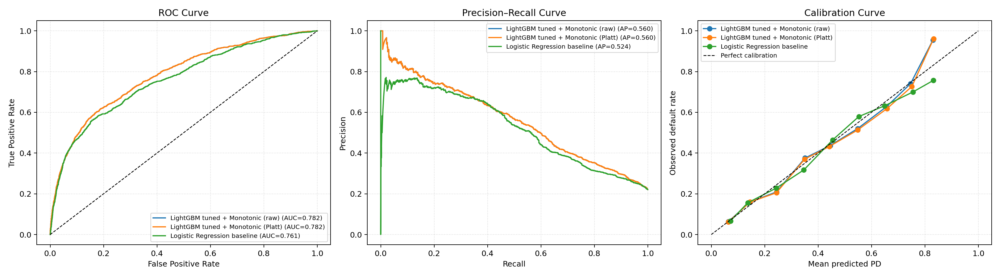

# Tuần 3 – T3: Đánh giá cuối trên tập Test

Test được đánh giá một lần. Mô hình, calibrator và ngưỡng đã khóa trước khi đánh giá: LightGBM tuned + monotonic, Platt fit trên Valid, ngưỡng 0.09 (làm tròn từ trung bình OOF EAD-weighted 0.088). Không điều chỉnh tham số theo kết quả Test.

Tỷ lệ default thực tế trên Test: **22.12%** (6,000 hồ sơ).

## Chỉ số phân tách và hiệu chuẩn

| Mô hình/đầu ra | ROC-AUC (bootstrap 95% CI) | Gini | KS (bootstrap 95% CI) | PR-AUC (bootstrap 95% CI) | Brier (bootstrap 95% CI) | Log Loss | ECE | Mean PD |
|---|---:|---:|---:|---:|---:|---:|---:|---:|
| LightGBM tuned + Monotonic (raw) | 0.7825 (0.7681, 0.7973) | 0.5649 | 0.4290 (0.4048, 0.4603) | 0.5600 (0.5315, 0.5887) | 0.1347 (0.1288, 0.1405) | 0.4284 | 0.0139 | 22.07% |
| LightGBM tuned + Monotonic (Platt) | 0.7825 (0.7681, 0.7973) | 0.5649 | 0.4290 (0.4048, 0.4603) | 0.5600 (0.5315, 0.5887) | 0.1348 (0.1288, 0.1405) | 0.4285 | 0.0163 | 22.37% |
| Logistic Regression baseline | 0.7609 (0.7461, 0.7765) | 0.5219 | 0.4046 (0.3771, 0.4341) | 0.5236 (0.4960, 0.5546) | 0.1384 (0.1322, 0.1446) | 0.4410 | 0.0185 | 22.01% |

Brier, Log Loss, ECE và Mean PD của Logistic baseline tính trên PD chưa hiệu chuẩn (baseline không qua Platt), nên không hoàn toàn ngang hàng với đầu ra Platt của mô hình cuối. ROC-AUC, Gini, KS và PR-AUC không phụ thuộc hiệu chuẩn.

## So sánh cuối với baseline Logistic Regression

- DeLong paired test: ΔAUC (LightGBM Platt − baseline) = **0.02150**, 95% CI [0.01449, 0.02852], p = **1.8616e-09**.
- Paired bootstrap 95% CI cho ΔAUC: [0.01434, 0.02857].
- Kết luận mức 5%: **có khác biệt có ý nghĩa**.

## Đối chiếu KPI tham chiếu (Charter mục 3.2)

Mốc sàn và mục tiêu suy ra từ CV trên Train; giá trị dưới đây đo trên Test của mô hình cuối (LightGBM tuned + monotonic, Platt). Gini = 2·AUC − 1, khoảng tin cậy của Gini suy từ khoảng tin cậy của AUC.

| Chỉ số | Test (bootstrap 95% CI) | Mốc sàn | Mốc mục tiêu | Kết quả |
|---|---:|---:|---:|:---|
| ROC-AUC | 0.7825 (0.7681, 0.7973) | 0.78 | 0.79 | Đạt sàn, chưa tới mục tiêu |
| Gini | 0.5649 (0.5362, 0.5946) | 0.57 | 0.59 | Dưới sàn (thiếu 0.0051) |
| KS | 0.4290 (0.4048, 0.4603) | 0.45 | 0.47 | Dưới sàn (thiếu 0.0210) |
| PR-AUC | 0.5600 (0.5315, 0.5887) | 0.56 | 0.58 | Dưới sàn (0.55996, thiếu 0.00004) |

- Khoảng tin cậy 95% của cả bốn chỉ số đều chứa mốc sàn, nên với cỡ mẫu Test (6.000 hồ sơ) chưa phân biệt được giá trị đo với mốc sàn ở mức 95%.
- Theo Charter mục 4, KPI tham chiếu chỉ là mốc so sánh, không bắt buộc. KPI chính (ΔAUC so với baseline có ý nghĩa thống kê) đạt.
- ROC-AUC CV của cùng mô hình cao hơn Test khoảng một độ lệch chuẩn CV (0.7906 so với 0.7825), phù hợp ghi chú ở Charter mục 3.2.

## Kết quả trên Test tại ngưỡng đã khóa (chọn trên Valid)

Ngưỡng PD = **0.09**; cutoff PDO = **553.9** điểm.

| Chỉ số | Ngưỡng 0.09 | Ngưỡng 0.50 |
|---|---:|---:|
| Precision | 28.02% | 65.63% |
| Recall | 92.46% | 36.70% |
| Flag rate | 72.98% | 12.37% |
| Unit expected cost/customer | 0.03377 | 0.06513 |
| EAD-weighted cost (NT$/customer) | 1634.49 | 2830.29 |

## Đồ thị

Chi tiết số liệu và khoảng tin cậy: `test_metrics.csv` và `test_comparison.csv`. Kết quả Test chỉ dùng nghiệm thu, không dùng đổi calibrator, ngưỡng hoặc mô hình.

## Dự đoán từng hồ sơ cho phân tích fairness

`scripts/export_test_predictions.py` ghi `test_predictions.csv` (ID, y_true, PD thô, PD sau Platt, PD của baseline) sau khi đánh giá ở trên hoàn tất, phục vụ phần fairness (`project_plan.md` mục 4.3, Tuần 3 – T3). Đây là lượt chấm Test thứ hai, chỉ để xuất đầu ra của các mô hình đã đánh giá, dùng đúng mô hình, calibrator và ngưỡng đã khóa; không tính lại chỉ số hiệu năng và không thay đổi quyết định nào.

Mô hình huấn luyện lại khớp mô hình đã đánh giá: PD trung bình của ba đầu ra lệch dưới 0.0001 so với `test_metrics.csv`; flag rate ở ngưỡng 0.09 là 72.90% (bảng trên: 72.98%, chênh 5 hồ sơ). Marker `test_predictions_export.json` chặn chạy lại. `test_predictions.csv` bị gitignore theo quy ước không commit dữ liệu.
